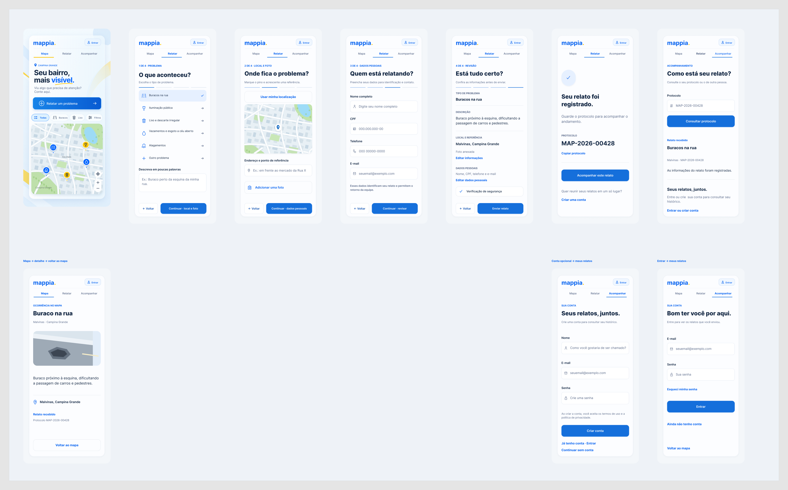

# Mappia

O Mappia é um projeto de extensão voltado ao registro e acompanhamento de problemas urbanos. A proposta permite consultar ocorrências no mapa, relatar um problema e acompanhar seu andamento por protocolo.

O Mappia cobre Campina Grande, PB. O site está em transição para aceitar relatos reais. O mapa público começa sem os registros da apresentação, e o formulário permanece fechado até a entrega por e-mail e SMS estar configurada e testada.

## Site

- [Abrir o Mappia](https://joaovitorregis.github.io/Mappia/) · [Painel do gestor](https://joaovitorregis.github.io/Mappia/gestor/)
- [Ativação e verificação da produção](docs/implementation/ATIVAR_PRODUCAO.md)

- [Protótipo navegável](https://www.figma.com/proto/sXNaua5CmhShdvoC4J4upn/Mappia?node-id=2031-152&page-id=0%3A1&starting-point-node-id=2031%3A152&scaling=scale-down)
- [Arquivo de design](https://www.figma.com/design/sXNaua5CmhShdvoC4J4upn/Mappia?node-id=2045-121)
- [Visão geral das telas](docs/design/telas-organizadas.png)

O novo fluxo envia o código de verificação ao e-mail ou telefone pelo serviço configurado. A conta continua opcional. O protocolo permite acompanhar a moderação, e o mapa mostra ocorrências aprovadas com posição aproximada. Fotos, referência livre e contatos ficam restritos à equipe. O envio e a conta pública dependem da ativação dos serviços.

Para executar localmente, rode `node dev/server.mjs` e abra `http://127.0.0.1:4173`. Para testar, execute `npm ci` e `npm test`. [Guia do Supabase](docs/implementation/SUPABASE_SETUP.md)

## Escopo planejado do MVP

- Registro de ocorrências com categoria, descrição, localização e foto opcional.
- Contato verificado por e-mail ou telefone, sem CPF; coleta em produção depende de finalidade, proteção e serviço de verificação definidos.
- Acompanhamento por protocolo e histórico para moradores com conta.
- Mapa público com ocorrências validadas e filtros por categoria.
- Área de moderação e atualização do estado das ocorrências.
- Contagens públicas por estado, somente de ocorrências validadas.

## Documentação

- [Requisitos do produto](docs/prd/PRD_Mappia.md) · [PDF](docs/prd/PRD_Mappia.pdf)
- [Product Backlog](docs/product-backlog/Product_Backlog_Mappia.md) · [PDF](docs/product-backlog/Product_Backlog_Mappia.pdf)
- [Jornada do usuário](docs/design/JORNADA.md)
- [Plano de implementação para quatro pessoas](docs/implementation/PLANO_MVP_4_PESSOAS.md)
- [Plano da versão para apresentação](docs/implementation/PLANO_GPT_APRESENTACAO.md)
- [Telas do protótipo](docs/design/telas)

## Equipe

Projeto de quatro estudantes de Ciência da Computação da UNINASSAU Campina Grande, na disciplina Atividades Práticas Interdisciplinares de Extensão I.

- [João Vitor Regis](https://github.com/joaovitorregis)
- [Ryan Cavalcante](https://github.com/Ryancscarvalho)
- [Joalison Normandia](https://github.com/joalisonnormandia)
- [Jhonatan Xavier](https://github.com/jhonatandevpb)

## Licença

A documentação e os designs de autoria da equipe Mappia estão sob [CC BY 4.0](LICENSE), incluindo o PRD, o Product Backlog e o protótipo identificado neste README.

Autoria: João Vitor Regis, Ryan Cavalcante, Joalison Normandia e Jhonatan Xavier. Ao reutilizar, credite os autores, informe as alterações e inclua um link para a licença.

Elementos de terceiros conservam seus próprios direitos e licenças. A licença não concede direitos sobre marcas, imagem ou dados pessoais.
