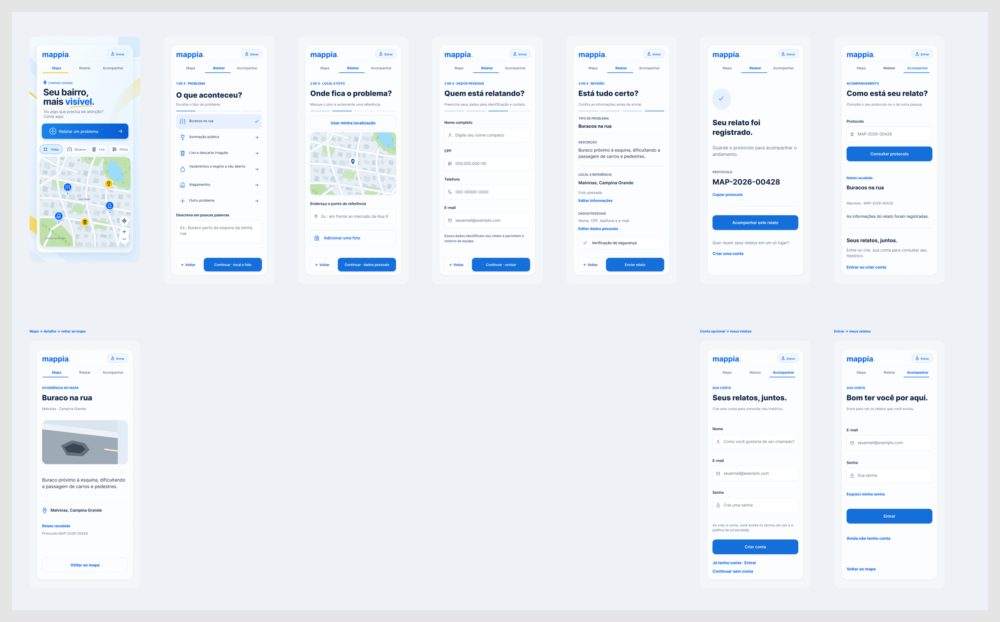

# Mappia

O Mappia é um projeto de extensão voltado ao registro e acompanhamento de problemas urbanos. A proposta permite consultar ocorrências no mapa, relatar um problema e acompanhar seu andamento por protocolo.

O projeto está em fase de prototipação. Este repositório reúne requisitos planejados, backlog, telas no Figma e uma demonstração estática em HTML/CSS/JavaScript.

## Protótipo

- [Protótipo navegável](https://www.figma.com/proto/sXNaua5CmhShdvoC4J4upn/Mappia?node-id=2031-152&page-id=0%3A1&starting-point-node-id=2031%3A152&scaling=scale-down)
- [Arquivo de design](https://www.figma.com/design/sXNaua5CmhShdvoC4J4upn/Mappia?node-id=2045-121)
- [Visão geral das telas](docs/design/telas-organizadas.png)

A [demonstração HTML](index.html) permite navegar pelo formulário em quatro etapas e consultar o exemplo fixo MAP-2026-00428. Ela termina na revisão: não envia relatos nem gera protocolos. Use apenas dados fictícios nos campos de nome, CPF, telefone e e-mail. Não há validação de identidade.

Envio, protocolo real, conta opcional e histórico são funcionalidades previstas. O mapa é uma prévia estática; filtros, GPS, autenticação, moderação e indicadores não estão integrados. As imagens acima são exportações históricas; consulte o [contrato e a matriz de capacidades](docs/prd/PRD_Mappia.md#contrato-da-demonstração---revisão-de-22102026).

As interações do Figma demonstram o fluxo de uso. O protótipo não está conectado a serviços de envio, autenticação ou atendimento.

## Escopo planejado do MVP

- Registro de ocorrências com categoria, descrição, localização e foto opcional.
- Etapa ilustrada de identificação; coleta em produção depende de decisão sobre necessidade dos campos, finalidade e proteção.
- Acompanhamento por protocolo e histórico para moradores com conta.
- Mapa público com ocorrências validadas e filtros por categoria.
- Área de moderação e atualização do estado das ocorrências.
- Contagens públicas por estado, somente de ocorrências validadas.

## Documentação

- [Requisitos do produto](docs/prd/PRD_Mappia.md) · [PDF](docs/prd/PRD_Mappia.pdf)
- [Product Backlog](docs/product-backlog/Product_Backlog_Mappia.md) · [PDF](docs/product-backlog/Product_Backlog_Mappia.pdf)
- [Jornada do usuário](docs/design/JORNADA.md)
- [Telas do protótipo](docs/design/telas)

## Equipe

Projeto de quatro estudantes de Ciência da Computação da UNINASSAU Campina Grande, na disciplina Atividades Práticas Interdisciplinares de Extensão I.

- [João Vitor Regis](https://github.com/joaovitorregis)
- [Ryan Cavalcante](https://github.com/Ryancscarvalho)
- [Joalison Normandia](https://github.com/joalisonnormandia)
- [Jhonatan Xavier](https://github.com/jhonatandevpb)

## Licença

A documentação e os designs de autoria da equipe Mappia estão sob [CC BY 4.0](LICENSE), incluindo o PRD, o Product Backlog e o protótipo identificado neste README.

Autoria: João Vitor Regis, Ryan Cavalcante, Joalison Normandia e Jhonatan Xavier. Ao reutilizar, credite os autores, informe as alterações e inclua um link para a licença.

Elementos de terceiros conservam seus próprios direitos e licenças. A licença não concede direitos sobre marcas, imagem ou dados pessoais.
